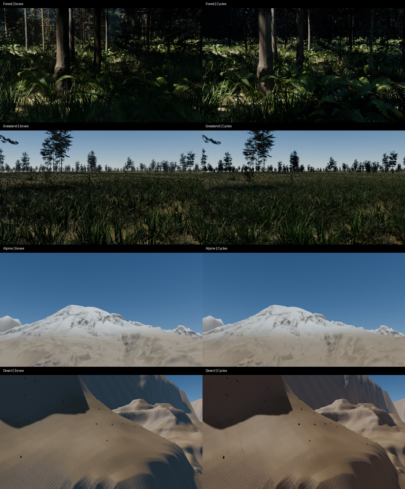

# Daylight, ground layers and clear-air development pass

Research and implementation: 22 October 2026. This is the optional 1.4 development pass; the public 1.3 beta remains the released baseline.

## Scope

The next three High priorities are related ground materials, consistent daylight/indirect lighting, and atmospheric entry. This pass implements a testable first stage of each. It does not close the broader photographic, animation or engine-agreement acceptance gates.

### Ground layers

Four existing CC0 Poly Haven scans supply aligned color, height and roughness: `leafy_grass`, `forrest_ground_01`, `brown_mud_leaves_01`, and `rock_boulder_dry`. The same normalized weights blend all three channels. Exposed steep faces receive more rock; forest cover adds litter; flatter moist areas receive more damp sediment. Moisture is an artistic control, not a computed drainage or erosion simulation. Rock strata and habitat-specific desert substrates still need further work.

Tile widths are 2 m, 2 m, approximately 1.3 m and 1.8 m respectively. Poly Haven's [asset API](https://api.polyhaven.com/api-docs/) defines dimensions in millimeters. Ground scan scale multiplies these footprints. Color is read as sRGB; roughness/height are Non-Color. Small-scale height controls bump above the existing displaced mesh. The real regional terrain, geometric waves and instanced vegetation remain in use.

Repeated texture coordinates use a wrapped geographic phase plus local coordinates. This avoids sending million-scale texture coordinates to the shader and preserves map phase across a floating-origin rebase. Broad material/habitat fields remain geographic.

### Matched daylight and finite indirect light

The development world uses Blender 5.2's `MULTIPLE_SCATTERING` Sky Texture, rotated into the same geographic east/north/up basis as the explicit Sun. Its sun disc is disabled because direct illumination comes from that Sun. The two legacy unshadowed fill suns contribute zero energy. Other user lights are preserved.

Ground illumination uses terrain altitude. The visible sky uses camera altitude. Flying upward therefore does not inadvertently raise the altitude of the atmosphere that illuminates the ground. Air/aerosol controls are shared. Sky strength is an exposed artistic calibration parameter; this pass does not claim a measured solar irradiance or photometric exposure calibration. Use the same exposure and display transform in both engines.

Without a suitable baked volume, Eevee's diffuse lighting can fall back to the world environment. That is particularly consequential under a dense canopy. [Blender's volume-probe documentation](https://docs.blender.org/manual/id/5.1/render/eevee/light_probes/volume.html) describes static diffuse captures, capture distance, surfel density and memory costs.

**Bake Current Shot Lighting** creates a bounded probe around the current detail camera, defaulting to a 90 × 90 × 36 m region and a 40 m capture distance. The default grid is 24 × 24 × 12 with 512 bake samples. Probe intensity stays at one. The same physical materials and Sun are used in Cycles; there is no per-engine material brightness multiplier.

The cache key includes world controls, physical scene scale, logical camera pose/lens/output size, mesh/placement arrays, material inputs and scene lights. A changed shot disables an outdated probe instead of silently reusing it. An identical deterministic detail rebuild can retain the capture. Save the `.blend` after baking. This is a static-shot workflow; changing geometry, water time, daylight or detail requires another bake. It is not dynamic global illumination or a moving-flight probe cache.

Automatic checks cover the exposed generator controls, top-level material inputs and scene geometry/lights. Direct edits inside nested/generated shader groups or externally overwritten image files require an explicit rebake. The capture is local: objects outside it can fall back to different indirect lighting. Larger capture dimensions are available, but do not by themselves qualify distant foliage.

### Clear-air entry prototype

A shared shader integrates exponential air and aerosol densities along a spherical, physically scaled ray. Two quadratically spaced sample intervals concentrate evaluation around the ray's closest approach. It clips rays against a 100 km clear-air boundary. Terrain and supported bundled vegetation use the same transmittance and in-scattering approximation. Leaf coverage is retained outside the aerial blend so empty parts of alpha cards remain empty.

The sky and haze use the same sun/up basis and density controls. The orbital boundary renders its back side, allowing opaque terrain to occlude it; it does not lay another unrelated haze over the terrain. The visible sky and boundary have a continuous altitude weight between 80 and 100 km. That is a prototype handoff requiring visual qualification, not a validated atmospheric lookup-table solution.

This implementation uses scalar extinction and sky-derived horizon radiance. It is **not** a spectral multiple-scattering transport solver. Native sky altitude is limited to 100 km, and the sky is Earth-oriented. Transparent multilayer transport, water reflections/refraction, clouds and arbitrary planetary atmospheres remain separate tests. Unsupported complex asset alpha graphs are reported and left unchanged. The existing distant cloud shell is retained; it is not a cloud volume that can be flown through.

The next atmospheric step should evaluate a shared LUT solution against [Bruneton's reference](https://ebruneton.github.io/precomputed_atmospheric_scattering/index.html) and [Hillaire's scalable model](https://sebh.github.io/publications/egsr2020.pdf), including horizon rays, night-side behavior and transparent layers. A port requires compatible native shader sampling and illumination, not only a sky background.

## Use

1. Use Blender 5.2+ and the complete runtime assets. Save a copy of the existing scene.
2. Select a living rocky planet. In **N → Open Planet → Development · Daylight & Ground**, select **Upgrade Daylight & Ground**.
3. Choose the shot/detail camera and output size. Adjust ground moisture, scan scale and daylight controls, then **Refresh Ground & Daylight**.
4. Lock the detail and shot. Choose a bounded capture width/distance and **Bake Current Shot Lighting**. Wait for Blender to finish; save the scene.
5. Compare Eevee and Cycles with identical exposure, AgX settings, camera and geometry. After changes, refresh and rebake. **Restore Beta Daylight** rebuilds the previous shader setup and restores source alpha.

Probe resolution and capture distance can be expensive. The development defaults were evaluated on an RTX 5090; no consumer-memory tier is qualified by this work.

## Experiments and evidence

Initial forest lighting experiments used a fixed 960 × 540 view. At the original dark exposure, the mean display-RGB difference dropped from 5.94% with legacy illumination to 0.79% with a matched sky and local capture. That low value was rejected as sufficient evidence because the images were too dark.

At +3 EV, the matched sky/capture pair had a 5.13% mean display-RGB difference, a mean signed brightness bias of −0.14%, and a 19.22% 95th-percentile absolute channel error. A more expensive 5 mm shadow test reduced whole-image MAE only to 5.03%. The capture substantially improves average forest illumination, but fine leaf shadows still disagree visibly. These experiments diagnose lighting; they do not establish photorealism or almost identical engines.

Reproduction tools:

```text
python -m unittest discover -s tests -v
blender --background --factory-startup --python-exit-code 1 --python tools/probe_daylight.py -- --variants sky,skyprobe --exposure 3
blender --background --factory-startup --python-exit-code 1 --python tools/validate_lookdev.py -- --site Forest
blender --background --factory-startup --python-exit-code 1 --python tools/validate_lookdev.py -- --site Forest --reload
```

The native tool expects `dist/Open-Planet-Designer-Beta-Demo.blend`, or an existing fixture in `output/next-realism`. It writes a separate review scene and paired images. It never overwrites the public beta scene. `render_look_review.py` makes static review pairs with locked geometry; the forest uses +3 EV and the other views use 0 EV, identical within each pair.

### Recorded development results

Blender 5.2.0 LTS / RTX 5090; 960 × 540 paired stills, 128 render samples per engine. The optional material/light/capture upgrade passed in forest, grassland, alpine and desert scenes. Eighteen portable math/terrain/ecology tests passed. Thirteen native round-trip checks passed, including saved capture persistence, placement/light invalidation, exact mesh-array restoration, alpha restoration, repeated upgrade, frozen-detail lighting, and the bake UI icon. See [the native results](verification/look-roundtrip-validation.json) and [readable review settings/timings](verification/readable-review.json).

| Static review | Exposure within pair | Mean display-RGB difference | 95th-percentile channel difference |
| --- | --- | --- | --- |
| Forest | +3 EV | 5.21% | 18.82% |
| Grassland | 0 EV | 2.68% | 10.20% |
| Alpine | 0 EV | 0.76% | 3.53% |
| Desert | 0 EV | 3.12% | 7.45% |



These are per-shot display comparisons, not scene-linear transport errors or a photographic approval. In a brighter grassland stress test at +3 EV, mean difference was 7.75%, with conspicuously pale Eevee crowns. Bypassing haze left 7.91%; a larger 500 m lighting capture only reduced the original test to 7.30%. Therefore haze is not the main cause of that discrepancy. Native material inspection found no source subsurface/transmission contribution to explain it. The finite captures and source-derived three-card distant crowns need further occlusion/lighting work; increasing capture dimensions does not close that gate. This pass preserves source foliage PBR instead of adding an unqualified brightness correction or whole-crown translucency.

Eight clear-air altitude pairs from 10–120 km, including 99/100/101 km, were rendered at 640 × 360 with the same +1.5 EV exposure. Mean engine differences were approximately 0.1–0.3%; no abrupt boundary discontinuity was evident between those sampled heights. The moving view camera was separate from the locked detail camera. After making shadow texel size follow the actual view altitude, the repeat completed without the earlier shadow-buffer-full warnings. [Altitude settings/timings](verification/clear-air-validation.json) are recorded. These are discrete static checks, not a continuous animation qualification.

**Visual failures remain:** the clear-air prototype washes out regional land contrast, snow/canyon surfaces still look overly smooth, and distant crown shading differs. Close engine agreement in the clear-air test does not make that atmosphere photographically acceptable. Regional land-cover reflectance, directional canopy occlusion, a better atmospheric radiance/transmittance model, hero geology and snow/substrate detail remain necessary. The three High roadmap items stay open.

## Remaining acceptance gates

- Photographic approval in forest, meadow, alpine and desert, including front light, backlight and overcast foliage tests.
- Clear-air views around the handoff, near the horizon and along an atmospheric descent; verify no duplicate haze or abrupt transition.
- Broader capture persistence across Blender versions and animated routes; the current static reload/edit/restore checks pass.
- Native visual rebase texture continuity and alpha-shadow coverage; portable phase math and the alpha restore/upgrade round trip pass.
- Scene-linear error and local shadow inspection in addition to display-RGB means.
- Temporal LOD, volumetric cloud entry, spectral ocean/foam, erosion/substrate data, and measured lower-memory hardware remain future development.

The [expanded proposal](EXPANDED_DISCUSSION.md) retains these High priorities as open until their visual and temporal gates pass.

The installable `1.4.0-dev.1` ZIP was extracted into an independent directory and imported in a fresh Blender process. Panel registration, ground-shader rebuilding from packaged assets, a fresh light bake and an Eevee render passed; all used file images in the saved review were packed. See [the package check](verification/development-package-smoke.json). This remains a development build, separate from the public beta release.
