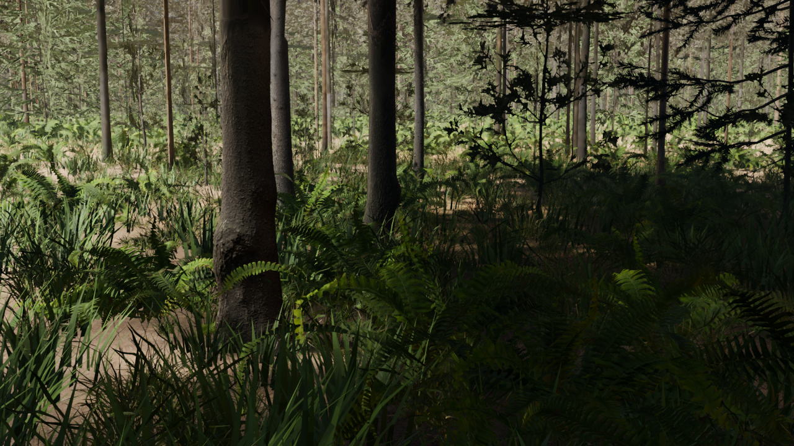

# Earth woodland visual development

**0.2.0-alpha.2 · Godot 4.7.2 Forward+ · 1 November 2026**

The current direction is natural daylight with subtle cinematic color: scanned Earth surfaces, readable plant forms, restrained warmth and atmospheric depth. This begins the visual benchmark in M4. Broader framework expansion and other planets are deferred. Photographic approval remains open; an engine name is not a visual-quality specification.

## Two scenes with different purposes

The app now opens **Earth Woodland Study**, a bounded local scene converted from the preserved Blender forest. It retains the original camera, 59,212 plant/rock instances, 500,000 terrain triangles and 4,999,998 expanded source scatter triangles. It uses the shared native asset catalogue, not a Blender installation or the old frozen-import folder at runtime. Its original source-selected detail is fixed. Moving away from the reference camera does not upgrade every plant's detail.

The **native planet**, reached with F2 or **Explore native planet**, continues to generate terrain and ecological cells. It shares the new surface/foliage appearance profile, but has its own population and terrain. Its current appearance is still less convincing than the fixed study. F2 or **Woodland visual study** returns from native mode. The old alpha and Blender releases remain preserved.

| Control in the study | Action |
| --- | --- |
| RMB / WASD / Q,E | Look / fly / down, up |
| Wheel / Shift | Change speed / boost |
| Home / Reset view | Original Blender camera |
| H / Esc | Hide interface / release mouse |
| Lighting selector | Natural daylight, reversed sun, or a diffuse-light study |
| Local bounced lighting | Toggle local SDFGI |
| Exposure | Adjust display exposure for inspection |
| F2 / Explore native planet | Enter the streaming generator |

Source entry points are `godot/woodland_study.tscn` and `godot/runtime.tscn`. `godot/launch.ps1 -Editor` opens the study; `-Native` runs the streamer. Runtime control changes remain session settings. Edit `godot/earth_woodland.tres` to change the shared appearance resource.

## Changes in this pass

- A shared Earth appearance resource controls daylight, HDR sky illumination, exposure, modest grading, foliage backlighting, ambient occlusion and screen-space indirect light. It does not define canonical terrain or plant identity.
- Ground shading adds original OpenGL normal maps, pine-needle litter, moss, aligned roughness/height maps and scan occlusion. Map scales are 2 m pine litter and 3 m moss. Scan channels share the same coordinates.
- Texture imports explicitly enable mipmaps and GPU compression. Normal reconstruction supports two-channel compressed normal maps. Native mesh UV wrapping now uses a common 234 m repeat period, with compatible moss-mask periods, to preserve differently scaled layers across tile boundaries. This changes the native mesh/cache revision to `native-3` without changing the height function.
- The local study tests SDFGI on stationary geometry. Distant alpha-card representations receive lighting but are excluded from static voxelization; treating those large cards as solid occluders produced false darkness. This local choice is not qualification of SDFGI in the rebased native world. SDFGI remains off there.
- The native forest adds denser, physically scaled understory, taller mature trees, scattered rocks, longer tree reach and a fourth representation stage. Reduced opaque wood/rock geometry is combined with retained crown cards; generic leaf simplification was rejected because it destroyed canopy coverage. These are hybrid representations, not fully geometric distant foliage.
- Native defaults are now 12 million expanded scatter triangles, 30,000 instances, 600 m requested tree reach, 12/95/180 m tree representation thresholds and 55 m ground-cover reach. The 144-cell request cap can reduce achieved reach. These are development settings, not a consumer-hardware preset. Terrain leaf/residency caps remain 384/2,048.
- Population changes are explicitly versioned as `earth-woodland-2`; old ecological caches are not reused. Identity remains stable within this revision. Dense cell cache payloads are bounded at 8 MiB, rather than incorrectly rejecting valid cells above 1 MB.

## CC0 Earth assets

New downloads are original Poly Haven maps: normal maps for the four retained ground scans, plus complete [Forest Ground 03](https://polyhaven.com/a/forrest_ground_03) and [Forest Leaves 02](https://polyhaven.com/a/forest_leaves_02) surface sets. The retained [Kloofendal partly cloudy pure sky](https://polyhaven.com/a/kloofendal_48d_partly_cloudy_puresky) supplies daylight. Poly Haven identifies its assets as [CC0](https://polyhaven.com/license). URLs, physical widths, channels, sizes and SHA-256 hashes are retained in `godot/assets/appearance/CREDITS.json`. Existing scanned plants/rocks retain their source credits.

The native catalogue now includes 42 retained variants and 74 unique image files, allowing the study to preserve all original plant variants. Seven additional hybrid representations are derived offline. No AI-generated landscape pictures or textures are used in these captures.

## Actual Godot captures

The eye-level study uses the original Blender camera and layout. The native comparison uses a different generator and a revised camera height/FOV; it is not a controlled lighting-only comparison. These images show current behavior, not photographic acceptance.



[Backlight study](media/woodland-look/study-backlight.png) · [Canopy view and remaining weaknesses](media/woodland-look/study-canopy.png) · [Native generator](media/woodland-look/native-forest.png)

## Remaining visual work

Canopy views still expose coarse cards, weak directional shading and overly bright foliage. Some procedural grass remains visibly simple. Close substrate needs loose debris, roots and small real geometry beyond normal-map detail. Shadows and indirect light need further review under movement and changing sun. The diffuse-light preset is a lighting study using the retained sky, not a complete overcast-weather simulation.

The local study has finite terrain/population coverage and fixed source-selected LODs. Its terrain has collision; plants do not form a complete walking/physics system. The shared look is not yet reproduced throughout the native planet. Planetary atmosphere, clouds, ocean optics, wind and other planets remain later work. An HDR sky and local fog do not establish atmospheric entry. No 8 GB GPU or clean-machine support claim is made.

The next visual gate is human review of the eye-level look, followed by improved canopy/grass representations and transferring the accepted result into a moving native region. The [verification report](verification/godot-woodland-look.json) records structural/render checks. [Archive checksums and extraction results](https://github.com/katfacey/Open-Planet-Designer/blob/godot-import/docs/verification/godot-woodland-package.json) are published separately to avoid self-referential source-archive checksums.

## Rebuild

The hydrated source archive already includes runtime assets and the baked study. Open it in the pinned Godot build and import. A GitHub source checkout alone does not contain those large files.

Offline reconstruction from the complete retained import masters uses:

```text
python tools/prepare_godot_catalog.py
python tools/prepare_earth_appearance.py
godot --headless --path godot --editor --import --quit
python tools/prepare_earth_appearance.py
godot --headless --path godot --editor --import --quit
godot --headless --path godot --script res://tools/prepare_forest_proxies.gd
godot --path godot --rendering-driver vulkan --script res://tools/build_woodland_study.gd
```

The final bake deliberately uses Vulkan: the Dummy headless renderer does not retain the GPU MultiMesh buffers required for scene serialization. It runs offscreen. The original Blender file is read-only reference data for this workflow; no Blender render or editing is required.

`tools/capture_godot_visual.ps1` renders fixed native/reference/study views. `godot/tests/visual_gpu_checks.gd` verifies actual instance buffers, a known original fern transform, original counts/FOV, proxy GI policy and physical terrain collision. Native core/lifecycle checks cover cache recovery, identity, hard limits, tile topology and physical texture phase. Use `tools/export_godot_runtime.ps1` and `tools/package_godot_runtime.py` for the separate visual build and hydrated source archives.
