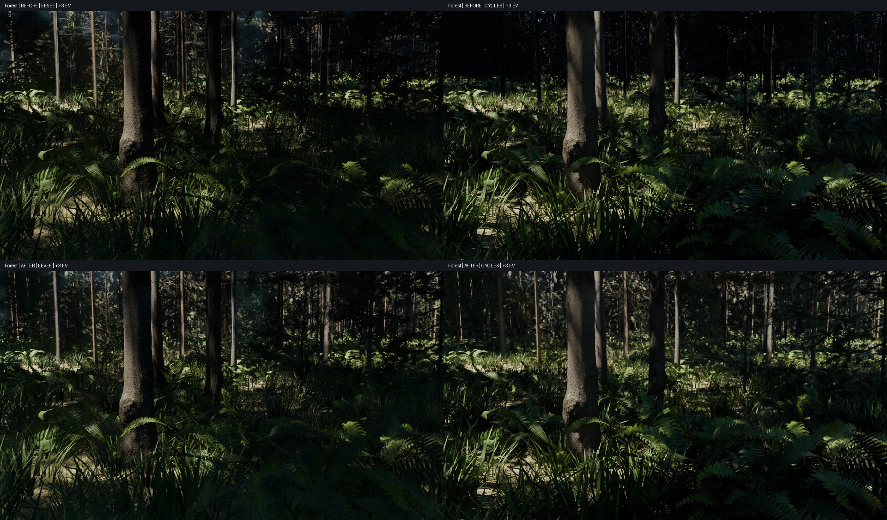
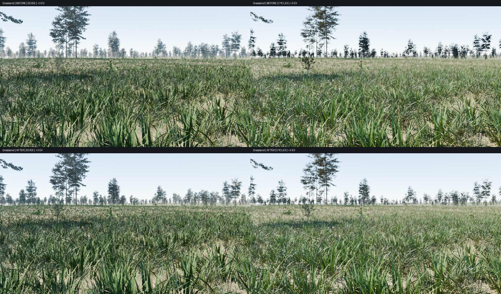
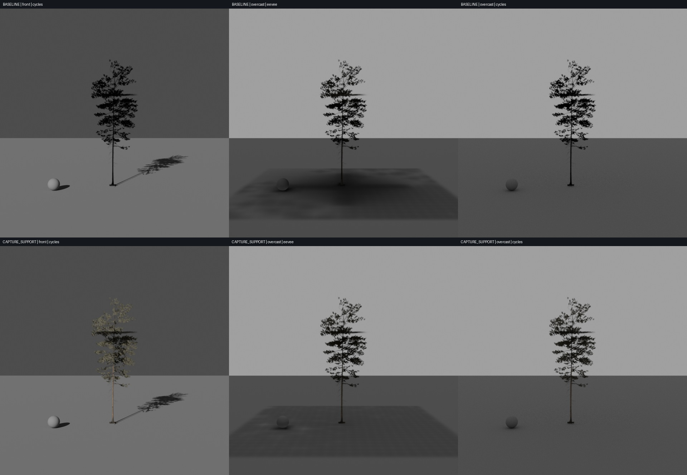

# Foliage lighting development

This optional 1.4 development pass addresses distant-tree normals and local Eevee light capture. It uses the existing CC0-derived trees, with the same materials and geometry in both engines. It does not qualify completed photorealism, seamless LOD animation or consumer hardware tiers.

## Controls

Use Blender 5.2+, the complete runtime assets and a living rocky world with **Upgrade Terrain & Forest Structure** and **Upgrade Daylight & Ground** enabled. In **N → Open Planet → Development · Daylight & Ground**, select **Repair Foliage Lighting**, then **Bake Current Shot Lighting**. Save the scene after the bake. An existing scene is upgraded explicitly; the public beta is unchanged.

The repair is idempotent. **Restore Beta Daylight** also restores the original normal links and source alpha. The repair does not change instance membership, placement, height or the runtime triangle budget. Camera/detail/material/light changes require a fresh static capture. Direct nested shader edits and overwritten external textures also require an explicit rebake.

## Findings and implementation

### Crown normal convention

The legacy distant representation consists of three source-derived image cards. The preparation tool encoded camera-space normals but fed them into a tangent-space Normal Map node. Camera forward is −Z, while a front-facing tangent normal uses +Z. For the tested pine front atlas, mean decoded blue was approximately −0.65; every opaque normal pointed into the card. Under front light the crown was almost black in Cycles as well as poorly matched in Eevee.

The repair changes encoded blue from `B` to `1 − B`, retaining red/green, strength, albedo, roughness and alpha. Both engines use the same correction node. Detection is limited to the bundled source-silhouette materials on tree LOD2, and checks the opaque atlas's normal direction. Already-outward maps and explicitly tagged new atlases are left alone. Preparation now writes the outward convention directly and tags it, preventing a second inversion. Detailed foliage/bark normal maps are untouched.

Nineteen visible atlas maps require correction. Two views of the existing dead-tree atlas are completely empty; the tool reports them and retains their original coverage. Regenerating and qualifying those views remains asset work.

### Alpha-aware static capture

Blender 5.2's [Eevee surface-capture shader](https://github.com/blender/blender/blob/blender-v5.2-release/source/blender/draw/engines/eevee/shaders/eevee_surf_capture.bsl.hh) creates lighting surfels over mesh surfaces after evaluating their material. Transparent regions on a large rectangular crown card can therefore affect the baked occlusion. An isolated overcast tree test showed a broad rectangular dark region beneath the cards. Changing RGB gutters or probe backface culling did not resolve it.

During a bake, each source card is temporarily replaced with a conservatively trimmed support mesh derived from its unchanged color-atlas alpha. A 64 × 64 max-filtered mask retains occupied leaf cells and thin branches. Oriented contours preserve holes and disconnected islands; Blender tessellates them with the original UV/material assignment. The area of the filled contours is checked against the mask. Transparent pixels inside retained cells still use the original shader alpha.

The first pine's support mesh has 492 triangles instead of six. This expansion is **capture-only**: all source data is restored in a `finally` block before rendering, cache signing or saving. Derived meshes and temporary curve objects are removed on success and failure. Runtime source costs, scatter budgets and deterministic plant IDs remain unchanged. Capture preparation and baking can still cost more memory/time; instancing the trimmed meshes across a forest is not free.

### Experimental capture floor placement — off by default

A no-tree control exposed another rectangular artifact when the lowest probe rows were underground. The optional **Experimental above-ground capture** places the local volume above the terrain height sampled at the detail camera; **Capture floor clearance** defaults to 0.3 m. Probe intensity remains one. Width, resolution, samples and capture distance retain their controls.

This reduced the enlarged isolated overcast tree comparison from 2.53% to 0.53% mean display-RGB difference when combined with the normal/alpha repairs. It was rejected as a general default: the forest's final comparison against the same corrected-normals Cycles reference rises from 4.74% to 9.45% when the grid is raised. Grassland improves from 7.38% to 6.83% in that display comparison, illustrating the scene dependence. The option is **off by default**. Keep it off for the supplied forest review; open scenes need individual evaluation.

This is a local placement correction, not a terrain-conforming probe lattice. Sloping ground can still intersect other rows. The capture is static and finite; distant trees outside it can receive different indirect light. No per-engine brightness, emission or shadow-removal compensation is used.

## Reproduction and acceptance

```text
python -m unittest discover -s tests -v
blender --background --factory-startup --python-exit-code 1 --python tools/check_foliage.py
blender --background --factory-startup --python-exit-code 1 --python tools/foliage_benchmark.py -- --variant baseline
blender --background --factory-startup --python-exit-code 1 --python tools/foliage_benchmark.py -- --variant capture_support
blender --background --factory-startup --python-exit-code 1 --python tools/foliage_benchmark.py -- --variant capture_fix
blender --background --factory-startup --python-exit-code 1 --python tools/validate_foliage.py
blender --background --factory-startup --python-exit-code 1 --python tools/check_foliage_capture.py
blender --background --factory-startup --python-exit-code 1 --python tools/measure_foliage_linear.py
python tools/report_foliage.py
```

These tools expect the preceding daylight review scenes in `output/next-realism`; they are development fixtures, not a clean-checkout one-command build. For constrained/shared GPU memory, use `validate_foliage.py -- --prepare-only`, allow that process to exit, then invoke `render_foliage_cycles.py` separately for each `--site Forest/Grassland` and `--variant before/after`. This avoids retaining Eevee capture resources during Cycles. The intended-size matrix uses `foliage_benchmark.py` with `--resolution 112 --levels 0,2 --rotation 90/180 --tag NAME-112`, and corresponding `--kind FIR` / `--kind SAPLING_B` cases; run the default `capture_support` variant at level 2 as well as baseline/experimental variants before regenerating the complete recorded report.

The controlled benchmark uses actual tree LODs, a neutral floor/reference sphere, uniform sky and three lighting directions. It writes scene-linear 32-bit EXR masters and AgX PNGs. `capture_support` tests the default repair; `capture_fix` additionally raises the floor and remains an experiment. The enlarged tree makes defects visible; 112-pixel test frames put the tree near its normal ≤65-pixel distant size, including 90°/180° pine rotations, fir and young pine. Backlighting remains a difficult case even for the detailed source, so whole-image agreement is not sufficient.

The forest/meadow test freezes existing placement arrays, uses the same +3 EV exposure and output settings within every pair, and checks original source identities, triangle accounting, normal idempotence, unchanged plant IDs and exception cleanup. Its scene-linear normalized error divides mean absolute RGB error by the mean brightness of the two linear images; it is not a display percentage or a photographic score.

## Recorded results

Blender 5.2.0 LTS, RTX 5090 and Core i9-14900K. Full scenes use frozen geometry, 960 × 540 output, +3 EV, 128 samples and Cycles denoising with 64 transparent bounces. The forest's completed baseline Cycles render used CPU; subsequent Cycles pairs ran in fresh OptiX processes. Devices and timings are recorded per case. Keeping the engines in separate processes avoided the severe slowdown seen while GPU memory was also occupied by another workload; these timings do not qualify an exclusive hardware performance tier.

| Full scene | Display RGB MAE before | After default repair | Channel p95 before → after |
| --- | --- | --- | --- |
| Forest | 5.22% | 4.74% | 19.22% → 16.47% |
| Bright grassland | 7.64% | 7.38% | 23.92% → 22.75% |

The forest's scene-linear normalized MAE changes from 66.11% to 52.74%. **Grassland's linear error worsens**, from 11.50% to 12.08% normalized MAE (absolute RGB MAE 0.01415 → 0.01483), despite its small display-space improvement. Its linear p95 also rises from 0.05778 to 0.06568. These remain substantial discrepancies; the default repair is not an across-the-board parity win. The corrected crowns receive more plausible front lighting in both engines, but indirect illumination and canopy shadows need further work.





| Enlarged isolated pine LOD2 | Display RGB MAE before | After default repair |
| --- | --- | --- |
| Front light | 0.387% | 0.308% |
| Backlight | 2.566% | 2.335% |
| Overcast | 2.529% | 1.737% |

The intended-size tests and linear-light measurements include pine rotations, fir and young pine, with separate results for the experimental floor change. All three directions remain in the record; averages are not used to hide a directional regression. Spatial tree-region crops include background and floor and are not semantic leaf-only masks.



See [machine-readable measurements and checks](verification/foliage-development.json). Twenty-three portable tests cover terrain/ecology/air plus alpha-support holes, diagonal islands and all 512 binary 3 × 3 masks. Native checks cover alpha identity, detailed-material scope, idempotence, outward-map protection, success/failure/partial-build cleanup, exact normal-link restoration, unchanged scatter arrays/counts/budgets, and saved capture edit/restore behavior. Probe transforms are signed from their editable channels to avoid false invalidation caused by loaded-matrix recomposition roundoff. Crown UVs, normal-node operations, alpha-shadow flags and probe settings are included in the capture key. The updated cache format requires old captures to be rebaked.

Remaining gates include directional canopy self-shadowing, backlit leaf transport, empty dead-tree views, multi-angle proxy quality, temporal transitions and lower-memory performance. Cycles diagnostics also show that the current aerial-perspective material creates many mesh-light candidates; separating aerial radiance from scene illumination needs a measured follow-up. These keep the broader foliage/lighting roadmap priority open.

The local `1.4.0-dev.2` ZIP was independently extracted, imported and registered in a fresh Blender process. Rebuilding the packaged ground shaders, repairing foliage, baking and rendering succeeded. All used file images in the saved review are packed; its capture and all 18 edit/restore checks also pass after a separate reopen. The fresh packaged shader render differs from the recorded forest render by only 0.00014% mean display RGB. See [the package check](verification/foliage-package-smoke.json). The development ZIP and packed review remain separate from the public 1.3 beta release.
