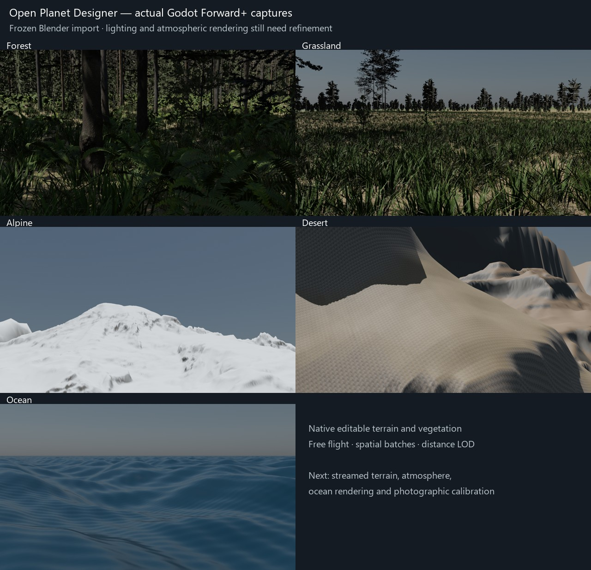

# Godot migration: first Blender import

1 November 2026. This is a Godot 4.7.2 Forward+ prototype using the existing Blender development review as its source. Godot is now the primary runtime/deployment target; the [implementation plan](GODOT_IMPLEMENTATION_PLAN.md) defines the next stages. The Blender add-on, original files and release remain available as the preserved authoring/reference baseline.

## Open it

The local project is `godot/project.godot`. Open it in Godot and press **F5**. On Windows, `godot/launch.ps1 -Editor` locates the installed Godot executable and opens the forest working scene. The prototype ZIP includes the generated assets. GitHub's automatic source ZIP does not include those large files.

The project uses GDScript and also works with the installed .NET edition without requiring a C# project. The [project guide](../godot/README.md) describes controls, editable scenes and rebuilding.

## Imported content

The source is `Open-Planet-Designer-1.4.0-dev.2-Review.blend`, evaluated at frame 240 without overwriting that file. Its SHA-256 is retained in the export manifest and verification report.

| Location | Evaluated terrain triangles | Exported plants / rocks |
| --- | ---: | ---: |
| Forest | 500,000 | 59,212 |
| Grassland | 499,996 | 65,298 |
| Alpine | 499,998 | 248 |
| Desert | 499,994 | 242 |
| Ocean | 500,000 | 0 |

These are complete exported populations and geometry counts, not the number visible in one rendered frame. Source placement IDs are unique within each exported site and retained in the instance buffers. The 42 shared prepared model/LOD variants include their scanned texture maps; ground layers reuse four existing scans at 2K.

Mesh coordinates are local to terrain chunks. The viewer keeps global movement in 64-bit scalar coordinates and rebases rendered coordinates in 256 m cells. Vegetation is grouped into spatial MultiMesh batches, using the source-selected LOD near the camera and cheaper prepared LODs farther away. Range controls cap every representation; they do not regenerate the source population.

## Native editing

The `godot/scenes/*.tscn` working scenes inherit generated native Godot review scenes. They expose terrain meshes, vegetation batches, camera, Sun and WorldEnvironment in the editor. Saved working-scene edits are used by the viewer. The main scene supplies the free-flight interface; the working scenes are editable static content.

The export copies retain original face-to-material assignments. An initial export-copy mistake cleared those assignments and was corrected before final checks. Legacy inward crown normals are corrected for glTF, aerial shader wrappers are removed from copies, and grass vertex-color tint is explicitly enabled in Godot. Alpha foliage uses scissor transparency. Source geometry/materials are not modified on disk.

## Scope and remaining work

This is a **frozen import with distance LOD**, not a completed procedural planet runtime. Moving outside the exported detailed regions does not generate new terrain, vegetation or collision. The remainder of the globe uses the exported coarse geometry. The overview key demonstrates geometry only; planetary sky/atmospheric entry is still pending.

Blender procedural shaders are not portable as native Godot shaders. Ground layering is rebuilt from the same scans/biome fields, and Godot lighting/sky is an initial approximation with the original Sun direction. The spherical atmosphere, cloud system, water optics and wave-time animation still need ports. Ocean displacement is present as a static mesh. Photographic fidelity and agreement with Blender reference renders are open.

The next runtime stage is background terrain-tile generation/streaming with stable populations, cache/prefetch and bounded upload work. Camera collision, physical atmospheric entry and ocean rendering follow as separate measured milestones. Lower-memory hardware and unrestricted streaming routes have not been qualified.

## Verification

`tools/validate_godot_export.py` validates source-file preservation, binary mesh sizes/indices, model texture presence, physical instance scales, IDs and counts. The Godot harness renders each location with Vulkan, saves native scenes and reopens them through the working scenes. It checks imported counts, chunk coverage, local camera coordinates after rebasing, small scalar motion, exact origin return, projection ratio and distance limits. A single-process lifecycle check loads all five locations and revisits the forest.

An early planetary far/near ratio collapsed Godot's CPU light-culling frustum; altitude-aware clipping fixed the resulting empty view and errors. The completed check logs must contain no engine/script errors and must produce fresh reports/images, preventing stale successful files from masking a failed run.

All five raw imports and saved working scenes rendered successfully with Godot 4.7.2, Forward+ and Vulkan on an NVIDIA RTX 5090 at 1280 × 720. Final logs contain no engine/script errors or warnings. The lifecycle check loaded all five locations and returned to the forest in one process. The existing 23 Python regression tests also pass.

A packaged copy was extracted to a separate folder with no `.godot` cache. Godot rebuilt that cache successfully, loaded all five inherited working scenes, and rendered the forest. The original packed Blender file still matches SHA-256 `28a6de888d430c16dbece2ee7598d96047b18ed99a73d819fd09fdd4374e42ab`.

The [machine-readable verification](verification/godot-import.json) records counts, checks and short stationary frame samples. The [package report](verification/godot-package.json) records the ZIP checksum. These measurements are diagnostic and do not qualify world streaming or other hardware.

| Saved working scene | Load time | Median frame interval | 95th percentile |
| --- | ---: | ---: | ---: |
| Forest | 4.53 s | 4.88 ms | 5.67 ms |
| Grassland | 3.65 s | 4.19 ms | 4.57 ms |
| Alpine | 1.24 s | 4.18 ms | 4.30 ms |
| Desert | 1.37 s | 4.18 ms | 4.29 ms |
| Ocean | 0.82 s | 4.18 ms | 4.30 ms |

Each frame sample covers two stationary seconds after loading/warmup. Results include the machine's display/scheduling limit. Tile generation, fast camera movement, peak memory and lower-memory GPUs have not been benchmarked.

These are actual Godot captures of the imported geometry. They show the current starting point: the vegetation transfers, while substrate repetition, mountain/canyon appearance, daylight balance and water/atmosphere remain visible refinement work.

