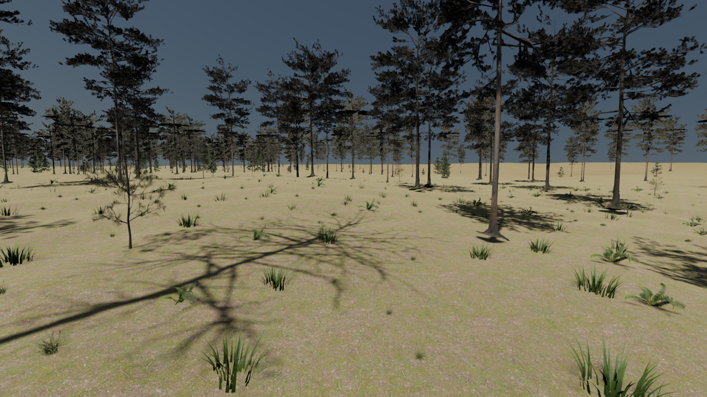

# Native Godot streaming alpha

**Historical 0.2.0-alpha.1 foundation report.** Current development is the [Earth woodland visual pass](EARTH_WOODLAND_LOOK.md), which starts in a bounded study. F2 or `launch.ps1 -Native` opens the native generator. The measurements/defaults below belong to the preserved alpha.1 build; alpha.2 has revised appearance, ecology and budgets.

**0.2.0-alpha.1 · 1 November 2026 · Godot 4.7.2 Forward+ / Windows x86-64**

This implements the first native versions of priorities 1–3: route profiling and an executable export; precise planet coordinates and shared terrain data; bounded terrain/ecosystem generation with distance LOD. It builds on the imported asset library and measured regions, and preserves the five frozen Blender review scenes as an optional reference mode.

The native world is a **new, versioned generator**, not a pixel-identical reconstruction of the Blender shader graph. Native plants have their own stable identity namespace. Forest/meadow terrain continues beyond the imported camera patches. Measured regions retain finite coverage and source resolution. Photographic approval, seamless vegetation transitions and consumer hardware qualification remain open.

## Run and explore

The Windows build is `dist/godot-runtime/OpenPlanetDesigner.exe`; keep its `.pck` beside it. The packaged runtime is `Open-Planet-Designer-Godot-0.2.0-alpha.1-Windows.zip`. It includes the application, notices, AI disclosure and source-credit manifests. It runs independently of Blender, Python and an installed editor. Exported-process checks record whether managed runtime modules were loaded; source editor tests use the installed .NET Godot edition.

For editing, open `godot/project.godot` and press **F5**, or run `godot/launch.ps1 -Editor`. `godot/runtime.tscn` is the new main scene. `godot/launch.ps1 -Editor -Review` opens the preserved forest working scene. The native source package includes hydrated native assets; the automatic GitHub source ZIP does not include the large generated asset files.

| Control | Action |
| --- | --- |
| RMB + mouse / WASD | Look and fly |
| E / Q, Shift, mouse wheel | Radial up/down, speed boost, speed adjustment |
| Home, location buttons | Dense forest, meadow, measured Rainier/canyon or pole bookmarks |
| O | Coarse orbital geometry preview; spherical sky/entry rendering is still pending |
| P | Replay the woodland/meadow route |
| V / H / Esc | Toggle vegetation / interface / release mouse |
| F8 | Save JSON profiling data and a `.frames` sidecar under the application's user-data folder |
| F1, source project only | Switch between native mode and the five frozen imported review locations |

The checkbox enables canonical terrain clearance and analytic collision against nearby resident trunks/rocks. It is a free-flight helper, not a walking/character controller or full mesh physics. Replay routes use their prescribed camera path rather than obstacle avoidance.

## Detail controls and saved configuration

The main panel exposes terrain error, tree reach and ground-cover reach. **Detail budgets** adds full/medium representation distances, terrain tile count, expanded scatter triangles, instance count, disk cache allowance, shadow reach and an SSAO toggle. The medium representation distance is constrained internally to exceed the full-detail distance. Changing a quality setting does not reseed the underlying candidate population.

Default limits are 384 terrain leaves, 2,048 resident terrain tiles including parents/staging coverage, two terrain generation jobs, two ecosystem cell jobs, 5,000,000 expanded source scatter triangles and 30,000 displayed plant/rock instances. Selection, seam planning, layout and cache eviction use separately bounded background tasks. GPU uploads are staged with a 2 ms target per subsystem; individual API/driver calls can exceed that target and are measured.

Tree reach defaults to 350 m, with detailed/medium thresholds near 9/65 m. Ground cover defaults to 45 m, with 12/26 m representation thresholds. Fixed per-instance variation spreads threshold changes. At most 144 ecological cell requests are retained; extreme reach requests or low budgets can reduce achieved coverage. The terrain display reports estimated error demand when the tile budget cannot meet the requested pixel error. A triangle count does not bound texture, shadow or alpha-overdraw costs.

Edit **`godot/default_planet.tres`** in Godot to persist the seed, radius, provider revision and budgets. Stop/restart the viewer to apply those resource edits. Runtime panel changes are session settings; a complete standalone planet save/load editor remains M9 work. The supplied Earth-scale configuration is the validated starting point; other scales/settings have not received the same rendering qualification.

## Coordinates and canonical terrain

`planet_location.gd` keeps absolute positions and cube-face fractions in scalar 64-bit arithmetic. Subtract the render origin before converting into ordinary Godot float vectors. Render origins snap in 256 m increments. Camera altitude and up derive from the actual planet centre; the navigation frame transports its orientation through movement instead of assuming a permanently flat Y-up world.

One height/mask provider supplies terrain vertices/normals, root placement, camera clearance and habitat fields. Seeded cubic value noise uses integer hashes and scalar interpolation; an independent weighted-corner Python reference and the retained Blender-independent cube mapping provide golden fixtures. Physical object sizes stay in metres. Ecological cell levels are chosen from planet radius to retain approximately metre-based spacing rather than using one fixed angular density for every radius.

The existing Rainier and canyon rasters are converted without Blender to little-endian uint16 height data, min/max pyramids and a versioned manifest. Source heights, 20/10 km footprints, original metadata and checksums are retained. Native placements and constant vertical offsets are explicitly new fictional-world choices. The approximate 4.88/2.44 m source sample spacings are not survey-accuracy or centimetre-detail claims. No per-pixel no-data mask survives in the preserved PNGs; the converter records this limitation rather than inventing one.

Regional data are checksum-verified on load. The two current height/bounds datasets are loaded into CPU memory; raster-page streaming is future work. Geometry is generated in local patches from the canonical fields. Near-ground height detail below the available samples comes from the declared procedural component or separate assets, not newly measured elevation.

## Terrain streaming and coverage

The selector maintains a complete cube-sphere quadtree, ranking displaced-surface error and reserving high priority for close vegetation contacts. Balancing splits are accounted for **before** spending the hard leaf budget, including rotated face borders. Neighbouring leaves differ by at most one level. Six coarse roots stay available.

Workers build 33 × 33 vertex patches. Border index patterns collapse fine odd edge vertices onto the coarse connectivity. Shared vertices sample the same canonical surface. Interior parent-triangle deltas support geomorphing; borders stay fixed, and morphing is disabled close to visible contacts to avoid burying grass. This is a first transition implementation, not a guarantee that every representation change is invisible.

Array generation/cache reads, tile selection and seam-mask planning run on owned worker data. Scene nodes, native mesh resources and GPU integration stay on the main thread. Old parent coverage remains until a complete replacement cover and its stitched meshes are ready, then visibility changes together. The handoff validates the actual resident cover's completeness and 2:1 boundaries, including partial loading; an unstitchable intermediate cover leaves the previous valid cover visible. Late jobs no longer demanded by the camera are discarded safely. A demand-generation token rejects obsolete seam plans.

Residency, in-flight jobs, uploads and retirement are bounded. Terrain caches use a typed header, payload length, SHA-256, atomic temporary-file replacement and version/provider namespaces. Periodic background eviction removes oldest-written cache files across old provider revisions/formats; cache hits do not refresh the file timestamps. The default terrain disk target is 64 MB, with a separate 32 MB ecological target; current writes and the eviction interval can temporarily exceed those targets. These are discardable caches, separate from saved settings and source assets.

Prefetch currently comes from the surrounding selected terrain/cell region. Velocity-aware predictive prefetch and more sophisticated emergency quality adaptation remain improvements for faster flight. During cold loading or excessive demand, coarse terrain can remain visible while fine detail arrives. The resident geometry and error counters expose this condition.

## Ecosystems and shared assets

Ecology cells are independent of render mesh LOD. Their full IDs include the planet/seed namespace, canonical cell and candidate coordinates. Ownership and candidate generation are independent of camera position, worker completion order, quality limits and cache residency. Terrain/water/slope/habitat rules determine eligibility; sizes, rotations and age/species choices remain deterministic.

The native catalogue contains 30 retained prepared model/LOD variants across mature pines, young pine/fir, dead wood, rocks, grass, ferns and wild grass. Its 68 unique texture files total roughly 92 MB on disk. External glTF image resources deduplicate identical texture bytes across variants. Those file sizes are not GPU memory measurements. Source material assignments, UVs, corrected crown normals and grass vertex tint are retained.

All curated catalogue meshes/textures are currently resident once loaded. There is one explicit runtime texture tier; mipmaps improve sampling but do not unload high-resolution maps. Texture-tier streaming and further proxy/asset curation remain future work.

Layout workers choose per-instance representations, reserve coarse coverage first and spend remaining triangle budget on nearby detail. A newly approached tree can select its original detailed mesh, independently of the old Blender camera's selection. Hard instance/triangle limits can downgrade or eventually cull farther instances; those actions do not change the canonical IDs. Spatial MultiMeshes use bulk buffers, shared mesh/material resources and persistent nodes where possible. Rebase offsets are applied to all displayed/staged batches.

Current representation changes remain discrete, with persistent threshold variation. Complementary transitions, directional canopy appearance, coverage-preserving far descriptors, wind and complete ecological/spacing rules are not qualified. The existing poor/empty distant atlas views remain asset work. The native alpha establishes streaming and identity; it does not close the photographic/temporal foliage gate.

## Profiling, replay and export checks

`tools/check_godot_runtime.ps1` runs serial Vulkan routes and records the actual framebuffer size. Its default request is a 1920 × 1080 window. Profiling uses the root window's pixel size, verified against the PNG readback: the pinned Windows build's `ViewportTexture.get_size()` can include an extra desktop scaling factor. The final forest/seam/orbit captures use 1920 × 1080; matched five-minute woodland runs use `-Resolution 1280x720`. The harness measures the actual renderer process, checks fresh outputs and engine errors, and records peak working set and observed managed-runtime modules. `-Executable` runs the exported app from an isolated folder. `-CacheNamespace` provides a fresh terrain/ecology cache without deleting the normal user's cache. It does not flush the driver's shader cache. Routes cover woodland travel/return, dense forest, a cube-face seam and orbital descent/exit; matched cold/warm comparisons use the same duration and resolution.

The in-app profiler stores a bounded 5 Hz timeline and complete float32 frame columns for up to 180,000 flight frames, including GPU/render CPU timing and streaming counters. It reports dropped frames explicitly beyond that limit. The `.frames` sidecar supports independent percentile checks; JSON summaries separate warmup from flight. RenderingServer memory counters are estimates, engine static allocation is not process RSS, and none is a substitute for total driver VRAM measurement on the target card.

The [verification report](verification/godot-native.json) records the final build checks and limitations. Test scripts cover independent scalar fixtures, centimetre precision, poles/corners, canonical face seams, all 16 stitch patterns, coarse/fine edge positions, physical regional samples, nearby detail priority, cache recovery, stable IDs, quality/seed changes, LOD upgrades, hard budgets and collision. A separate delayed-worker lifecycle test exercises complete fallback coverage, eviction, return/cache loading and rebase correctness during travel.

Run `python tools/verify_godot_native.py` after the named route captures to recompute percentiles from every saved binary frame column and check the hard counters. Raw route reports and sidecars remain under `output/`; the compact public report contains their hashes. The [package report in the repository](https://github.com/katfacey/Open-Planet-Designer/blob/godot-import/docs/verification/godot-native-package.json) identifies the archives and post-packaging cold-import checks; it is kept outside the source ZIP to avoid a self-referential checksum.

Bounded risk probes exercise depth-aware spherical air compositing with cutout trees/opaque water and SDFGI before/after a rebase. They establish API feasibility only. The diagnostic air shader is not enabled in the runtime; shared sky/ground lighting, spectral/LUT transport, true transparent-water ordering and clouds remain M5–M7 work. SDFGI remains off by default pending streaming-canopy quality and cost tests. The [reference board](GODOT_REFERENCE_BOARD.md) supplies licensed photographic targets for M4.

This build has been exercised on the RTX 5090 development machine. It has **not** qualified the proposed 8 GB GPU tier, a separate clean Windows machine, Linux or photographic quality. Long-route counters and local folder-only export tests do not establish universal hardware support.

### Recorded final-build runs

All five exported-app routes finished without engine errors, lost frame records or hard budget overruns. The 27 core checks and 7 delayed-worker lifecycle checks pass. Every saved frame column was independently checked against its reported percentiles. The preserved forest/grassland reference scenes also reload with their original geometry/instance counts.

| Flight | Pixels | Flight seconds | Frame p95 / p99, ms | Peak process RAM, GiB | Flight frames over 100 ms |
| --- | --- | --- | --- | --- | --- |
| Dense forest | 1920 × 1080 | 30 | 18.15 / 22.35 | 1.08 | 0 |
| Cube-face crossing | 1920 × 1080 | 30 | 18.91 / 29.94 | 1.15 | 0 |
| Orbit, descent and reverse exit | 1920 × 1080 | 60 | 18.27 / 26.63 | 1.17 | 0 |
| Woodland/return, cold application cache | 1280 × 720 | 300 | 20.25 / 30.55 | 1.24 | 1 |
| Same woodland/return, retained cache | 1280 × 720 | 300 | 17.98 / 23.38 | 1.23 | 1 |

Each run has 15 seconds of warmup before the measured flight. The two five-minute flights each contain one long interval: **130.99 ms cold, 118.11 ms warm**. Their maximum resident terrain counts are 534/535 against the 2,048 cap; all routes stay below the configured leaf, worker, scatter-triangle and instance limits. Warm cache means whatever survives the configured disk target, rather than a guarantee that the entire route remains cached. Upload targets remain soft, with individual calls exceeding 2 ms. Frame intervals include presentation/OS effects and are not raw GPU throughput. This evidence does not close the hardware or temporal-quality gates.

## Actual alpha captures

These are unedited screenshots from the exported application, not appearance targets. The forest still shows sparse cover, simplified lighting and discrete representations. Its structural streaming checks do not imply photographic approval.



[Cube-face crossing capture](media/godot-native/native-seam.png) · [Coarse orbital preview](media/godot-native/native-orbit.png). The orbital image exposes the current ground-oriented sky limitation; production planetary atmosphere is not implemented.

## Rebuild

Use the pinned Godot build and matching Windows export templates. The installed .NET editor can export this GDScript application without a C# project. With the complete preserved import assets available:

```text
python tools/prepare_godot_regions.py
python tools/prepare_godot_catalog.py
python tools/write_native_fixtures.py
godot --headless --path godot --editor --import --quit
godot --headless --path godot --script res://tests/native_core.gd
godot --headless --path godot --script res://tests/streaming_lifecycle.gd
```

On Windows, run `tools/export_godot_runtime.ps1 -GodotPath PATH_TO_GODOT`, then `tools/check_godot_runtime.ps1 -Executable PATH_TO_EXPORTED_EXE`. `tools/package_godot_runtime.py` packages the exported app and an editable native project with generated native assets. The native project archive excludes the large frozen import fixtures; the full source checkout can retain both modes.

Asset conversion tools require the original loose regional PNGs and the prepared import GLBs. Those masters are separate from running/editing the hydrated native project. Increment the generator/cache revision when changing canonical sampling or mesh data rules. Preserve user-edited resources and the Blender review before regenerating assets.
